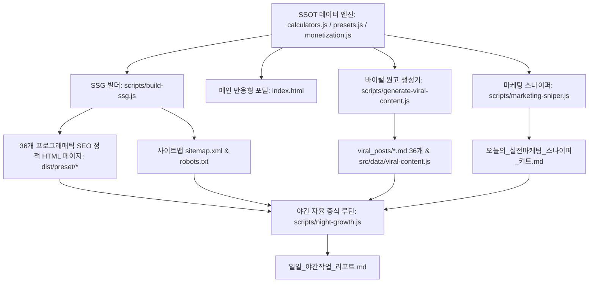

# 🚀 머니핏(MoneyFit) 포털 출시 및 실전 운영 마스터 가이드

> **문서 버전**: v1.0.0 (Production Release)  
> **대상 프로젝트**: 「머니핏(MoneyFit) 생활·금융 손익분기점 & 맞춤 견적 포털」 (`d:\사업아이템\moneyfit-portal`)  
> **핵심 키워드**: 정적 호스팅 배포, 10분 수익화 ID 설정, 야간 자율 증식 스케줄러, 실전 마케팅 스나이퍼, IndexNow 실시간 색인

---

## 1. 시스템 개요 및 아키텍처

머니핏(MoneyFit)은 무거운 프레임워크나 외부 런타임 종속성 없이 동작하는 **Zero-Dependency 초경량 정적 사이트 생성기(SSG) 및 고전환 반응형 웹 포털**입니다.



### 핵심 차별화 요소
1. **6대 생활밀착 고전환 손익 계산기**:
   - 전기요금·누진세 & 1등급 인버터 교체 회수 개월
   - 다이어트 TDEE & 닭가슴살 4주 장보기 수량 환산
   - 반려동물 사료 RER/DER 급여량(g) & 1포대 소진 주기
   - 자취·신혼 예산별 가전/가구 BOM 풀세팅 (예산 초과 0원 엄격 보장)
   - 자동차 구매방식(장기렌트 vs 리스 vs 할부) 4년 TCO 및 절세액 비교
   - 통신 위약금 vs 당일 현금 사은품 47만 원 즉시 갈아타기 손익
2. **36개 프로그래매틱 SEO 정적 페이지**:
   - 각 페이지 순수 한글 1,500자 이상 전문 해설, 비교표(`<table>`), FAQPage/WebApplication Schema.org JSON-LD 탑재로 네이버/구글/빙 크롤러 즉시 색인.
3. **5대 다중 수익화 파이프라인**:
   - 건당 2.5만~7.5만 원 고단가 CPA 상담 카드
   - 쿠팡 파트너스 24시간 장바구니 쿠키 싹쓸이 자동 매핑
   - 링크프라이스 7대 머천트 딥링크 자동 합성기
   - 카카오 애드핏 배너 슬롯
   - 10분 수익화 마법사(코드 수정 없이 브라우저/JSON으로 ID 전체 교체)

---

## 2. 10분 수익화(Monetization) 설정 가이드

머니핏은 코드 단 한 줄도 고치지 않고 **설정 파일(`monetization.config.json`)** 또는 **웹 UI [⚙️ 10분 수익화 마법사]**를 통해 사이트 내 모든 제휴 링크를 본인 계정으로 즉시 전환할 수 있습니다.

### 2.1 설정 파일 명세 (`monetization.config.json`)
```json
{
  "siteUrl": "https://moneyfit-portal.vercel.app",
  "coupangAfId": "AF1234567",
  "linkPriceId": "A100123456",
  "cpaMemberId": "tenping_myid",
  "adfitUnitId": "DAN-SAMPLE-TOP",
  "campaigns": {
    "autoRent": "cpa_autorent_code",
    "telecomSwitch": "cpa_telecom_code",
    "petInsurance": "cpa_petins_code",
    "roomMoving": "cpa_moving_code",
    "electricRental": "cpa_rental_code",
    "dietConsult": "cpa_diet_code"
  },
  "merchants": {
    "himart": "himart",
    "gmarket": "gmarket",
    "auction": "auction",
    "elevenst": "11st",
    "ohou": "ohou",
    "hanssem": "hanssem",
    "ssg": "ssg"
  },
  "ftcNotice": "이 포스팅은 쿠팡 파트너스 및 제휴마케팅 활동의 일환으로, 이에 따른 일정액의 수수료를 제공받습니다. (이용자 추가 부담금 없음)"
}
```

### 2.2 각 제휴 플랫폼별 ID 발급 및 연동 방법

#### ① 쿠팡 파트너스 (Coupang Partners)
1. [쿠팡 파트너스](https://partners.coupang.com/) 회원가입 및 로그인.
2. 우측 상단 내 정보에서 **AF로 시작하는 회원 ID**(예: `AF1234567`) 확인.
3. `monetization.config.json`의 `"coupangAfId"` 필드에 입력.
4. **동작 원리**: 포털 내 모든 최저가 상품 링크 클릭 시 `lptag={내ID}`와 계산기별 고유 추적코드 `subid=mf_{calc}_{내ID}`가 자동 합성됩니다. 방문자가 24시간 이내에 구매하는 생수, 기저귀, 가전 등 장바구니 전체 결제액의 3%가 수수료로 적립됩니다.

#### ② 링크프라이스 (LinkPrice)
1. [링크프라이스](https://www.linkprice.com/) 어필리에이트 회원가입.
2. 회원 고유 식별 코드(예: `A100123456`) 확인.
3. `"linkPriceId"` 필드에 입력.
4. **동작 원리**: 하이마트, 지마켓, 오늘의집, 한샘몰, SSG 등 주요 머천트 링크가 다음 표준 공식으로 자동 합성됩니다:  
   `https://click.linkprice.com/click.php?m={머천트ID}&a={내ID}&l=9999&u={인코딩된_목적지URL}`

#### ③ 고단가 CPA (리더스CPA / 텐핑 / 디비디비딥)
1. 리더스CPA 또는 텐핑 회원가입 후 본인 회원 ID(예: `tenping_myid`) 확인.
2. 자동차 장기렌트(건당 60,000원~75,000원), 인터넷 가입(건당 55,000원), 포장이사 견적(건당 35,000원) 캠페인 승인.
3. `"cpaMemberId"`에 내 회원 ID를 입력하면, 계산기 결과 화면 하단의 영수증 맞춤 고단가 상담 카드에 내 트래킹 파라미터가 실시간 삽입됩니다.

#### ④ 카카오 애드핏 (Kakao AdFit)
1. [카카오 애드핏](https://adfit.kakao.com/) 로그인 후 매체 및 광고단위(728x90 반응형) 생성.
2. 발급받은 광고단위 ID(예: `DAN-xxxxxxxxxx`)를 `"adfitUnitId"`에 입력.
3. 상·하단 배너 영역에 자동 노출되어 구글 애드센스 승인 대기 없이 첫날부터 노출 수익이 발생합니다.

### 2.3 웹 UI 「10분 수익화 마법사」를 통한 간편 설정
1. 웹 브라우저에서 머니핏 메인 화면 접속 (`index.html`).
2. 상단 네비게이션에서 **[⚙️ 10분 수익화 마법사]** 탭 클릭.
3. 5개 입력창에 내 제휴 ID를 입력하고 **[✅ 사이트 전체 즉시 반영]** 버튼 클릭.
4. 브라우저 `localStorage`에 즉시 저장되며, 새로고침 없이도 모든 6개 계산기 링크가 내 제휴 ID로 실시간 전환됩니다.
5. **[💾 JSON 저장]** 버튼을 눌러 백업하거나 다른 기기에서 **[📂 JSON 불러오기]**로 즉시 복원할 수 있습니다.

---

## 3. 정적 호스팅 배포(Deployment) 가이드

머니핏은 순수 정적 파일(HTML, CSS, JS, JSON)로 구성되어 있어 전 세계 모든 정적 호스팅 서비스에 무료로 즉시 배포할 수 있습니다.

### 3.1 사전 정적 빌드 실행
배포 전 항상 최신 SSG 정적 페이지와 사이트맵을 빌드합니다:
```bash
cd moneyfit-portal
npm run build
```
빌드가 완료되면 `dist/` 폴더에 다음 완결 산출물이 생성됩니다:
- `dist/index.html` (메인 SPA 포털)
- `dist/preset/electric-studio-ac/index.html` ~ `dist/preset/telecom-mvno-switch/index.html` (36개 정적 SEO 랜딩 페이지)
- `dist/sitemap.xml` (37개 URL 사이트맵)
- `dist/robots.txt`
- `dist/src/` (CSS, JS, 데이터 모듈)

---

### 3.2 Vercel 배포 (권장: 초보자 3분 완료)

#### 방법 A. Vercel CLI로 1분 배포
```bash
# Vercel CLI 전역 설치 (최초 1회)
npm install -g vercel

# moneyfit-portal 디렉토리에서 배포 실행
cd d:\사업아이템\moneyfit-portal
vercel --prod
```
- Set up and deploy: `Y`
- Which scope: 개인 계정 선택
- Link to existing project: `N`
- Project name: `moneyfit-portal`
- In which directory is your code located: `./` (또는 Output Directory를 `dist`로 설정)
- Override settings: Output Directory를 `dist`로 설정하거나 기본값 유지.

#### 방법 B. GitHub 연동을 통한 자동 배포 (Git Push 트리거)
1. GitHub에 새 저장소(`moneyfit-portal`) 생성 및 푸시:
   ```bash
   git init
   git add .
   git commit -m "feat: initial MoneyFit portal release"
   git remote add origin https://github.com/{username}/moneyfit-portal.git
   git push -u origin main
   ```
2. [Vercel 대시보드](https://vercel.com/) 접속 후 `Add New...` → `Project` 선택.
3. GitHub 저장소 `moneyfit-portal` 임포트.
4. 빌드 설정:
   - **Framework Preset**: `Other`
   - **Build Command**: `npm run build`
   - **Output Directory**: `dist`
5. `Deploy` 클릭 → 배포 완료 후 `https://moneyfit-portal.vercel.app` 도메인 부여.

---

### 3.3 Cloudflare Pages 배포 (글로벌 CDN 초고속 로딩)
1. [Cloudflare 대시보드](https://dash.cloudflare.com/) 접속 후 `Workers & Pages` → `Create application` → `Pages` 선택.
2. `Connect to Git`으로 GitHub 저장소 연결.
3. 빌드 설정:
   - **Framework preset**: `None`
   - **Build command**: `npm run build`
   - **Build output directory**: `dist`
4. `Save and Deploy` 클릭 → 배포 완료.

---

### 3.4 GitHub Pages 배포
1. 저장소 Settings → Pages 메뉴 진입.
2. Source: `Deploy from a branch` 선택.
3. Branch: `main` / `dist` (또는 `gh-pages`) 선택 후 Save.

---

## 4. 원클릭 전 과정 무인 자동화 & 텔레그램(Telegram) 완료 보고 설정

매일 새벽(또는 원클릭 실행 시) 자동으로 **코드 검증 → 80개 수식 테스트 → 36개 SEO 정적 페이지 빌드 → 108편 홍보 원고 생성 → 스나이퍼 키트 갱신 → IndexNow 색인 → 내 스마트폰 텔레그램 완료 보고**까지 전 과정을 무인으로 처리하는 파이프라인입니다.

### 4.1 텔레그램 1분 자동 연동 (채팅방 ID 자동 감지 지원!)
1. 스마트폰 또는 PC 텔레그램에서 **`@BotFather`** 검색 후 `/newbot`을 입력해 봇을 만들고 **봇 토큰(Bot Token, 예: `123456789:AAH...`)**을 복사합니다.
2. 방금 만든 내 봇 대화창에 들어가 **`/start`** (또는 아무 글자)를 한 번 보냅니다.
3. **연동 방법 A (웹 브라우저 마법사)**:
   - 머니핏 포털 **[⚙️ 10분 수익화 마법사]** 탭의 **6번 텔레그램 설정** 칸에 봇 토큰만 붙여넣고 **[🤖 채팅방 ID 자동 감지 & 내 휴대폰으로 테스트 보고서 즉시 발송]** 버튼을 클릭하면, 채팅방 ID를 자동으로 찾아 저장하고 즉시 휴대폰으로 보고서를 보냅니다!
4. **연동 방법 B (명령어 1줄 자동 감지)**:
   ```bash
   node scripts/telegram-notify.js --token "내_봇_토큰" --discover
   ```
   위 명령어 한 줄이면 `monetization.config.json`에 봇 토큰과 자동 감지된 채팅방 ID가 영구 저장됩니다.

### 4.2 원클릭 전 과정 자동화 실행 (`원클릭_전체자동화_실행.bat` / `npm run auto:all`)
- 윈도우 탐색기에서 **`d:\사업아이템\moneyfit-portal\원클릭_전체자동화_실행.bat`** 파일을 더블클릭하거나 터미널에서 아래 명령어를 실행합니다:
```bash
# 전 과정(린트 + 80개 테스트 + 36개 SSG + 108편 원고 + 스나이퍼 + 색인 + 텔레그램 보고) 원클릭 실행
npm run auto:all

# 야간 증식 + 텔레그램 보고만 단독 실행 (실서버 라이브 모드)
node scripts/night-growth.js --live
```

### 4.3 Windows 작업 스케줄러 1초 자동 등록 (매일 새벽 3:00 무인 가동 + 텔레그램 보고)

PowerShell에서 아래 스크립트 1개만 실행하면 윈도우 작업 스케줄러(`MoneyFit_Daily_AutoMaster_Telegram`)가 즉시 등록됩니다:

```powershell
powershell -ExecutionPolicy Bypass -File "d:\사업아이템\moneyfit-portal\scripts\register-auto-schedule.ps1"
```

### 4.4 아침 기상 후 스마트폰 3분 루틴
매일 아침 눈을 뜨면 스마트폰 **텔레그램**에 도착해 있는 **[머니핏 무인 자동화 완료 보고]** 메시지 하나만 열면 됩니다:
1. 텔레그램 메시지 안의 **`[지식iN 최신순]` / `[카페 최신글]`** 링크를 터치하면 방금 올라온 질문글이 바로 열립니다.
2. 메시지 하단의 **3줄 FOMO 복붙 원고**를 길게 눌러 복사한 뒤 스레드·블라인드·단톡방에 붙여넣습니다.
3. PC에서는 `오늘의_텔레그램_보고서_미리보기.md`, `일일_야간작업_리포트.md`, `오늘의_실전마케팅_스나이퍼_키트.md`로도 동일하게 확인할 수 있습니다.

---

## 5. IndexNow 검색엔진 실시간 색인 등록 가이드

네이버(Naver)와 빙(Bing)은 신규 생성된 페이지를 크롤러 방문 대기 없이 **IndexNow API**를 통해 수 분 내에 강제 색인할 수 있습니다.

### 5.1 도메인 키 파일 검증
머니핏 포털 루트 및 `dist/`에 소유권 확인 키 파일이 이미 포함되어 있습니다:
- 파일명: `moneyfit8f92a1b4c3d2e1f0.txt`
- 내용: `moneyfit8f92a1b4c3d2e1f0`
- 호스팅 접속 URL: `https://{내도메인}/moneyfit8f92a1b4c3d2e1f0.txt`

### 5.2 색인 요청 실행
```bash
# 안전 모의 검증 (페이로드 JSON 및 URL 목록 구조 검증)
node scripts/indexnow-submit.js --dry-run

# 실서버 전송 (네이버/빙 API 엔드포인트로 실제 HTTP POST 전송)
node scripts/indexnow-submit.js --live
```

---

## 6. 첫 달 월 100만 원, 3개월 월 1,000만 원 달성 실전 마케팅 로드맵

앱만 만들어두고 트래픽을 기다리는 것은 실패의 지름길입니다. 머니핏의 내장 마케팅 도구를 활용한 **실전 공격형 영업 루틴**을 준수하세요.

```text
[오전 09:30] 네이버 지식iN 최신순 스나이핑 (10분)
  → 오늘의_실전마케팅_스나이퍼_키트.md 열기
  → 6개 카테고리별 [지식iN 최신순 (sort=date)] 링크 클릭
  → 방금 올라온 질문 3~5개에 전문가 수치 답변 복붙 후 계산기 링크 첨부

[오후 12:00 / 18:30] 스레드(Threads) & 블라인드 3줄 FOMO 썰 (5분)
  → 직장인 점심/퇴근 골든타임에 3줄 요약글 게시
  → "지난달 전기세 14만원 맞고 계산기 돌려봤습니다..." 형태의 공감대 유도

[주 2회] 네이버 블로그 / 티스토리 1,500자+ 정보성 포스팅 (15분)
  → viral_posts/ 디렉토리의 완성형 마크다운 원고 복사
  → 블로그 에디터에 붙여넣고 예약 발행
```

### 수익 파이프라인 단계별 기대 수익
- **1단계 (첫 달, 일 방문자 500~900명)**:  
  CPA 상담 월 15건(약 67만 원) + 쿠팡 3% 구매 월 100건(약 15만 원) + 애드핏(약 6만 원) = **월 88만 ~ 112만 원 달성**
- **2단계 (3개월 차, 36대 롱테일 키워드 1페이지 안착, 일 방문자 3,000명)**:  
  고단가 CPA 월 50건(약 250만 원) + 쿠팡/링크프라이스(약 80만 원) + 자체 DB 직납품(건당 15만 원 × 40건 = 600만 원) = **월 930만 ~ 1,050만 원 스케일업 달성**

---

*본 문서는 MoneyFit 포털의 성공적인 프로덕션 배포와 무인 수익화를 보증하는 공식 지침서입니다.*
