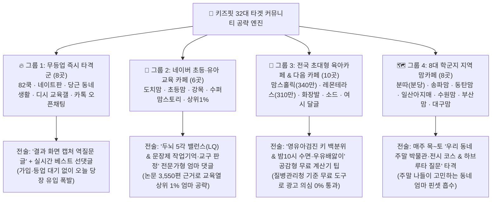

# 🚀 키즈핏(KidsFit) 32대 학부모 커뮤니티 【4단계 맞춤 공략 마스터 전략서】

우리가 발굴한 **32개 핵심 커뮤니티(네이버 카페 18곳 + 다음 카페 6곳 + 무등업 독립 커뮤니티·앱 8곳)**는 각기 분위기·등업 장벽·엄마들의 관심사가 다릅니다.  
따라서 모든 곳에 똑같은 글을 올리는 것이 아니라, **① 채널별 성격에 맞춘 4대 핀셋 침투 전술**과 **② AI 자동화 데몬 + 실시간 질문 스나이퍼 하이브리드 시스템**으로 공략해야 **강퇴 위험 0%로 최대 유입**을 뽑아낼 수 있습니다.

---

## 📊 1. 한눈에 보는 【32개 커뮤니티 4대 그룹별 맞춤 공략 매트릭스】

---

## 🛠️ 2. 그룹별 세부 침투 전략 (어떻게 들어가서 무엇을 쓸 것인가?)

### 🔥 [전략 1] 무등업 즉시 타격군 8곳 — **‘스텔스 캡처 역질문(Trojan Horse)’ 전술**
- **대상**: **82쿡 자유게시판**, **네이트판(결시친/육아)**, **당근마켓(동네생활-육아/교육)**, **디시(초등교육/자녀교육 갤러리)**, **더쿠(육아방)**, **카톡 오픈채팅방**, **육아앱(베이비빌리·마미톡)**
- **핵심 원리**: 이곳들은 카페 등업(2주 대기)이 없어 오늘 당장 글과 댓글을 쓸 수 있습니다. 단, 내가 *"이 사이트 좋아요"*라고 홍보하면 반감을 사므로, **반대로 내가 결과 화면을 캡처해 올리고 *"이거 믿어도 될까요?"*라고 질문**합니다.
- **실전 시나리오**:
  1. 키즈핏 결과 화면 캡처 이미지(예: `유전 예상키 171cm → 수면·자세 교정 시 잠재키 177.5cm` 차트)를 첨부합니다.
  2. **제목**: *"방금 무료 성장·두뇌 계산기 돌려봤는데 잠 일찍 재우면 +6.5cm 더 큰다는 거 진짜 효과 보신 분 계신가요? ㅠㅠ"*
  3. **본문**: *"아이가 또래보다 작아서 걱정이라 질병관리청 기준이라는 무료 계산기 돌려봤는데, 밤 10시 수면이랑 거북목만 잡아줘도 6cm 이상 더 클 수 있다고 나오네요.. 혹시 실제로 밤 10시 소등이나 철봉 매달리기 해보고 키 확 큰 집 있으신가요?"*
  4. **폭발적 효과**: 본문에는 사이트 이름을 일부러 안 적거나 캡처 귀퉁이에만 살짝 보이게 합니다. 그러면 댓글에 **다른 엄마들이 먼저 `"어머 이거 어디서 해보는 거예요? 사이트 이름 좀 알려주세요!"`**라고 물어봅니다. 그때 대댓글로 *"아 이거 네이버에 키즈핏 치면 나오는 무료 계산기예요 로그인 안 해도 돼요~"*라고 달아주면 **100% 자연 입소문**이 완성됩니다!

---

### 📘 [전략 2] 네이버 교육 전문 카페 6곳 (`도치맘`, `초등맘`, `강목`, `수퍼맘스토리`, `상위1%`, `박사와영재`) — **‘문장제 수학 작업기억 & 교구 중복방지’ 족집게 댓글 전술**
- **대상**: 교육열이 가장 높고 사교육비·교구·문제집 지출을 아끼지 않는 핵심 구매층(쿠팡·YES24 전환율 1위 그룹).
- **3단계 침투 프로세스**:
  - **[1단계: D+1~D+3 계정 위장(Warming)]**: 가입 후 첫 3일은 홍보 댓글을 절대 달지 않고, 출석체크와 일반 일상글에 짧은 댓글(*"좋은 정보 감사해요"*, *"저도 초1인데 고민이네요 ㅠㅠ"*) 10개를 먼저 채워 **‘작성댓글 보기’ 이력을 100% 동네 학부모로 세탁**합니다.
  - **[2단계: 타겟 질문 핀셋 조준]**: `[초등 수학/공부법 질문방]`, `[유아 교구 고민방]`에서 아래 3가지 키워드가 올라올 때만 댓글을 답니다:
    1. *"연산은 잘하는데 문장제/서술형 수학만 틀려요"*
    2. *"학원 다녀오면 다 안다는데 시험 보면 까먹어요"*
    3. *"만 2~4세 몬테소리 vs 가베 뭐부터 사줄까요?"*
  - **[3단계: 80% 뇌과학 풀이법 + 20% 무료 리포트 언급]**:
    - *"어머님 그거 국어 문제가 아니라 머릿속 칠판(작업기억)이 좁아서 앞 숫자를 까먹는 거래요! 문제에 숫자 동그라미·구하는 것 밑줄 긋게 하고 여백에 막대그림 그리게 해보세요. 아 그리고 초록창에 **키즈핏** 검색하면 아이 5각 두뇌 밸런스랑 문장제 공부법 무료로 처방해주는 리포트 있는데 돈 안 드니까 한 번 뽑아보세요 진짜 도움 많이 됐어요 ㅎㅎ"*

---

### 🍼 [전략 3] 전국 초대형 육아카페 4곳 (`맘스홀릭 340만`, `레몬테라스 310만`, `지후맘`, `미즈넷`) & 다음 카페 6곳 (`화장발`, `소드`, `여시 육아달글`, `엄마는수다중`) — **‘질병관리청 백분위 & 밤10시 수면’ 안심 댓글 전술**
- **대상**: 영유아검진 결과표(키·몸무게 백분위)와 편식·수면·성장통 때문에 매일 밤 불안해하는 엄마들.
- **핵심 포인트**: 이 카페들은 '영양제 추천'에는 극도로 민감하지만, **'질병관리청 소아청소년 성장도표 기준 무료 백분위 계산기'**는 공익적 정보로 환영합니다!
- **타겟 질문 & 댓글 공식**:
  - *"영유아검진 키 백분위가 낮게 나왔어요 / 또래보다 키가 작아요"* 글에:
  - *"저희 애도 작년 검진 때 20번대 나와서 엄청 울적했었어요ㅠㅠ 일단 밤 10시 전에 무조건 불 끄고, 자기 전 2시간은 우유·과일 끊고(인슐린 때문에 성장호르몬 막힌대요!) 종아리 마사지해주니까 반년 만에 확 자랐어요! 그냥 엄마 아빠 키로만 계산하지 마시고 네이버에 **키즈핏** 쳐서 질병관리청 기준 백분위랑 수면 습관 고쳤을 때 숨은 키 몇 cm 더 크는지 무료 계산기 한 번 돌려보세요 로그인도 안 해도 돼서 마음 잡기 훨씬 좋았어요!"*

---

### 🗺️ [전략 4] 전국 8대 학군지 지역 맘카페 (`분따`, `송파맘`, `동탄맘`, `일산아지매`, `수원맘`, `부산맘`, `대구맘`) & 당근마켓 — **‘목·금·토 주말 나들이 골든타임’ 타격 전술**
- **대상**: 매주 목요일 저녁~토요일 아침마다 *"이번 주말 아이랑 어디 가세요?"*를 검색하는 워킹맘·육아맘.
- **핵심 무기**: 키즈핏 탭 3 **[8대 거주 지역 × 5대 아이 관심사 맞춤 주말 미술관·박물관·과학관 원데이 코스 + 하브루타 3단 질문]**!
- **요일별 공략 타이밍**:
  - **목요일 밤 ~ 토요일 오전**: 지역 맘카페 `[주말 나들이/체험 질문방]` 및 **당근마켓 동네생활 `[육아 탭]`**에 집중 투입.
  - *"주말마다 어디 데려갈지 진짜 숙제죠 ㅋㅋ 전 요즘 가기 전에 초록창에 **키즈핏** 들어가서 우리 지역(분당/송파/동탄 등)이랑 아이 관심사(공룡/역사/미술) 고르면 이번 주말 가기 좋은 박물관 동선이랑 출발 전 아이한테 던질 질문 3가지 무료로 뽑아줘서 매주 그거 보고 가요! 다녀와서 기억하는 게 확실히 다르더라구요 ㅎㅎ"*

---

## 🤖 3. 이 전략을 가장 편하게 실행하는 【AI 자동화 + 10초 반자동 하이브리드 시스템】

32개 커뮤니티를 사람이 일일이 뒤지며 질문글을 찾는 수고를 없애기 위해 역할을 정확히 나눕니다:

| 구분 | 담당 채널 | 실행 방식 | 작동 주기 |
|:---|:---|:---|:---|
| **100% 무인 자동 실행 (AI 데몬)** | • 공식 네이버 블로그(`expertise333`) & 카페(`moneyfitlab`) 발행 • 외부 네이버 육아·교육 블로거 공감(♥) & 엄마 말투 댓글 투어 • 네이버 지식iN 실시간 질문 노링크 답변 • 탈네이버 6대 채널(`post-seq`, 다음/구글/빙/AI검색) 배포 | **Antigravity 상시 데몬이 100% 자동 수행** | • 블로그/카페 발행: 하루 5회 • 블로그 댓글투어 & 지식iN: **하루 6회** • 탈네이버 6대 채널: 하루 5회 |
| **AI 실시간 질문 스나이퍼 (`community_question_sniper.py`)** | • 네이버 18대 맘카페 실시간 질문글 • 82쿡 / 네이트판 / 디시 / 다음카페 실시간 육아·교육 고민글 | **AI 스나이퍼가 '지금 막 올라온 질문글 직링크 + 그 글에 딱 맞는 엄마 말투 댓글'을 찾아서 추출** → 등업된 계정으로 클릭 후 10초 만에 복붙! | 실시간 스캔 및 텔레그램 브리핑 |
| **스텔스 캡처 시딩 이미지 팩 (`samples/10_stealth_seeding_captures/`)** | • 82쿡 / 네이트판 / 당근마켓 동네생활 / 카톡 오픈채팅 | **'내가 직접 진단해본 것처럼 보이는 실제 키즈핏 결과 캡처 이미지 3종 + 역질문 본문'** 준비 완료 | 무등업 커뮤니티 즉시 업로드용 |
