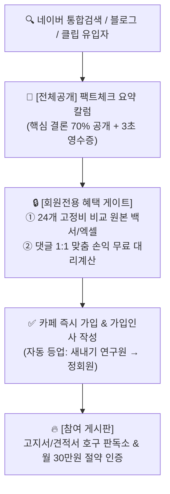
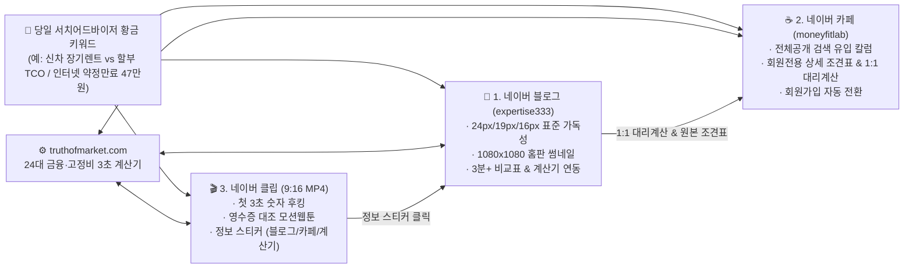

# 🦅 [제2본부 `expertise333` 전담] 네이버 트리플 10K(블로그 이웃 10,000명 · 카페 회원 10,000명 · 클립 팔로워 10,000명) 단일 카테고리 마스터플랜

- **문서 번호**: `DIV2-TRIPLE10K-MASTERPLAN-2026`
- **작성 및 총괄**: 제2본부(`expertise333`) 전담 **매파 분석관 🦅 (네이버 홈판·인기카페·클립 트렌드 & 서치어드바이저 키워드 수석 분석관)**
- **적용 대상 채널 (제2본부 전용 트리플 미디어)**:
  1. **네이버 공식 블로그**: `https://blog.naver.com/expertise333` (목표: **진성 구독자·서로이웃 10,000명+** & 홈판 경제M/머니판 상시 진입)
  2. **네이버 공식 카페**: `https://cafe.naver.com/moneyfitlab` [머니핏 생활금융·절세 팩트체크 연구소, Club ID: `31805224`] (목표: **가입 회원 10,000명+** & 카페탭/통합검색 상위 장악)
  3. **네이버 공식 클립(Naver Clip)**: `expertise333` 공식 클립 크리에이터 채널 (목표: **클립 팔로워 10,000명+** & `1080x1920` MP4 숏폼 정보 스티커 전환)
  4. **심층 계산기 엔진 허브**: `https://truthofmarket.com` (블로그·카페·클립 3대 채널의 1원 단위 실증 시뮬레이터 데이터 원천)

---

## 📌 1. 실제 웹 리서치 & 벤치마킹 기반 3대 알고리즘 해부 (왜 '단일 카테고리'인가?)

### 1-1. 네이버 C-Rank & D.I.A.+ 알고리즘의 냉혹한 진실: "잡블로그는 홈판에 절대 못 올라간다"
2025~2026년 네이버 모바일 첫 화면(**홈피드/홈판**)과 주제판(**경제M판, 머니판, 리빙판, 카테크판**)의 AI 추천 엔진(AiRS + C-Rank + D.I.A.+)을 실전 벤치마킹한 결과, 가장 치명적인 실패 원인은 **주제 분산(Topic Dilution)**입니다.

| 구분 | ❌ 실패하는 잡블로그·잡카페 (`C-Rank` 분산형) | ✅ 홈판·인기카페·클립이 밀어주는 상위 1% (`C-Rank` 집중형) |
| :--- | :--- | :--- |
| **주제 구성** | 아침엔 닭가슴살 다이어트(`diet-*`), 점심엔 강아지 사료(`pet-*`), 저녁엔 자동차 렌트(`auto-*`) 포스팅 | 365일 오직 **「실전 생활금융 · 세금환급 · 고정비 절세/재테크」** 단 하나의 맥락(Context)만 집중 타격 |
| **네이버 AI의 출처 평가** | *"이 계정은 맛집/건강 블로그인가, 반려동물 블로그인가, 경제 블로그인가?"* → **전문성 지수(C-Rank) 하위 40% 고착** | *"이 계정은 대한민국 가계 고정비·절세·금융 손익계산 분야 상위 1% 전문 출처다!"* → **경제M/머니판 우선 배정** |
| **독자 구독 전환율** | 자동차 글 보고 들어왔다가 다음 날 고양이 사료 글을 보고 **이웃 취소 / 클립 언팔로우** | 어떤 글을 클릭해도 내 지갑에서 새는 돈을 막아주는 영수증 분석이 나와 **블로그 이웃 + 카페 가입 + 클립 팔로우 동시 전환** |
| **애드포스트 & 제휴 단가** | 저단가 식음료·잡화 광고 혼합으로 평균 CPC **150~300원** | **금융·보험·캐피탈·통신·세무·고효율가전** 고단가 광고 100% 매칭으로 평균 CPC **1,200~3,500원** |

### 1-2. 제2본부(`expertise333`)의 단 하나의 초강력 핵심 카테고리 선언
> 🏆 **제2본부 단일 플래그십 카테고리 (Single Flagship Category)**
> ### **「실전 생활금융 · 세금환급 · 고정비 절세/재테크」**
> *(네이버 블로그·서치어드바이저·크리에이터어드바이저 공식 단일 카테고리: **`[비즈니스·경제]`**)*

- **포괄 범위 (100% 돈·요금·세금·손익분기점 관점으로 통일)**:
  1. **자동차 금융·절세**: 신차 장기렌트 vs 오토할부 vs 현금일시불 5년 총소유비용(TCO), 개인/법인사업자 연 1,500만 원 비용처리 절세, 자동차세 연납 공제, 초보운전 보험료 할증 방어
  2. **통신 금융·위약금 손익**: 인터넷·TV 3년 약정 만료 현금 사은품(47만 원) vs 요금할인 손익분기점, 잔여 위약금 대납 순수익, 온가족 결합 할인, 5G→알뜰폰(MVNO) 24개월 고정비 절감액
  3. **에너지·공과금 환급**: 한국전력 주택용 누진세(1~3단계) 폭탄 방어, 한전 에너지캐시백, 으뜸효율/1등급 인버터 가전 교체 시 정부 환급금 및 기기값 회수기간(ROI)
  4. **주거·초기자금 고정비 재테크**: 원룸·오피스텔·신혼집 입주 시 예산별(50만~1,000만 원) 감가상각 방어 최적 BOM 견적, 관리비·전월세 세액공제 연계 고정비 절감

---

## 🧹 2. 기존 `expertise333` 36개 자산 전수 감사: 1군 주력(24선) vs 영구 제외(12선)

네이버 C-Rank(`비즈니스·경제`) 단일 전문성을 극대화하기 위해 기존 36개 프리셋 자산을 전수 심사하여 **24개 주력 금융/절세/고정비 테마는 1군으로 확정**하고, C-Rank를 깎아먹는 **식단/다이어트(`diet-*` 6종) 및 반려동물 사료(`pet-*` 6종) 총 12종은 `expertise333`에서 영구 제외(Pruning)**합니다.

### ✅ [보존 및 집중 육성] 제2본부 `비즈니스·경제` 1군 주력 라인업 (24개 테마)

| 클러스터 분류 | 프리셋 슬러그 (ID) | 핵심 재테크·손익분기점 주제 | 계산 요약 (3초 영수증 팩트) | 홈판 타깃 판 |
| :--- | :--- | :--- | :--- | :--- |
| **① 자동차 금융·절세 (6종)** | `auto-grandeur-5000` | 개인/법인사업자 5,000만 원 그랜저 장기렌트 절세 손익 | 연 1,500만 원 비용처리 · **[신차 장기렌트] 총 2,733만 원 이득** | 경제M / 카테크 |
| **① 자동차 금융·절세 (6종)** | `auto-avante-3000` | 20대 사회초년생 3,000만 원 아반떼 장기렌트 vs 할부 5년 TCO | 초보 보험료 할증 방어 · **[신차 장기렌트] 총 1,063만 원 이득** | 경제M / 카테크 |
| **① 자동차 금융·절세 (6종)** | `auto-tucson-hybrid` | 3,800만 원 투싼 하이브리드 48개월 장기렌트 vs 할부 비교 | 취등록세·자동차세 합산 · **[신차 장기렌트] 총 1,715만 원 이득** | 경제M / 카테크 |
| **① 자동차 금융·절세 (6종)** | `auto-genesis-g80` | 7,000만 원 제네시스 G80 법인/고소득자(35% 세율) 36개월 손익 | 법인/고소득 절세 극대화 · **[신차 장기렌트] 총 3,084만 원 이득** | 경제M / 카테크 |
| **① 자동차 금융·절세 (6종)** | `auto-casper-cash-vs-rent` | 1,800만 원 캐스퍼 경차 초보운전 보험료 포함 할부 vs 렌트 | 취등록세 감면 vs 보험료 · **[신차 장기렌트] 총 558만 원 이득** | 경제M / 카테크 |
| **① 자동차 금융·절세 (6종)** | `auto-ev-ioniq` | 5,500만 원 아이오닉 전기차 보조금 800만 원 반영 48개월 손익 | 배터리 감가 헤지 · **[신차 장기렌트] 총 2,842만 원 이득** | 경제M / 카테크 |
| **② 통신 위약금·약정 (6종)** | `telecom-3yr-expired` | 인터넷 3년 약정 만기(위약금 0원) 신규 이동 시 47만 원 혜택 | 위약금 0원 · **현금 사은품 + 요금절감 총 +79만 원 이득** | 경제M / 머니판 |
| **② 통신 위약금·약정 (6종)** | `telecom-penalty-15` | 인터넷+TV 잔여 위약금 15만 원 시 타사 이동 사은품 순수익 | 위약금 15만 원 차감 후 **당일 통장 총 +52만 원 이득** | 경제M / 머니판 |
| **② 통신 위약금·약정 (6종)** | `telecom-penalty-30` | 약정 1년 남은 통신 위약금 30만 원 vs 사은품 47만 원 손익 | 위약금 30만 원 내고도 **갈아타기가 총 +53만 원 이득** | 경제M / 머니판 |
| **② 통신 위약금·약정 (6종)** | `telecom-single-oneroom` | 자취방 인터넷 단독 위약금 8만 원 vs 지원금 25만 원 비교 | 원룸 단독 회선 이동 시 **총 +57만 원 순이익** | 경제M / 리빙판 |
| **② 통신 위약금·약정 (6종)** | `telecom-family-4p` | 온가족 4인 인터넷+TV+휴대폰 통합 결합 변경 최대 사은품 손익 | 위약금 12만 원 차감 후 **4인 결합 총 +93만 원 이득** | 경제M / 머니판 |
| **② 통신 위약금·약정 (6종)** | `telecom-mvno-switch` | 5G 고가 요금제 → 알뜰폰 유심 요금제 전환 시 24개월 절감액 | 위약금 10만 원 내고도 **2년간 통신비 총 +107만 원 절감** | 경제M / 머니판 |
| **③ 한전 누진세·환급 (6종)** | `electric-studio-ac` | 원룸 벽걸이 에어컨 하루 10시간 한 달 전기세 & 누진세 계산 | 월 추가 전기세 **+35,335원 (총 59,223원)** 정밀 진단 | 경제M / 리빙판 |
| **③ 한전 누진세·환급 (6종)** | `electric-stand-ac` | 30평대 2in1 스탠드 에어컨 누진세 3단계 폭탄 & 캐시백 방어 | 누진 3단계 진입 시 **추가 +281,057원 (총 331,183원)** | 경제M / 리빙판 |
| **③ 한전 누진세·환급 (6종)** | `electric-dehumidifier` | 여름철 제습기 24시간 가동 전기요금 & 1등급 환급 교체 손익 | 월 추가 전기세 **+51,961원 (총 86,514원)** · 1등급 회수기간 | 경제M / 리빙판 |
| **③ 한전 누진세·환급 (6종)** | `electric-dryer` | 전기 히트펌프 의류건조기 주 4회 사용 시 전기세 & 으뜸환급 | 월 추가 전기세 **+21,833원 (회당 1,360원꼴)** 팩트체크 | 경제M / 리빙판 |
| **③ 한전 누진세·환급 (6종)** | `electric-winter-heater` | 겨울철 2000W 전기온풍기 하루 8시간 난방비 누진세 폭탄 진단 | 월 추가 전기세 **+166,023원 (총 211,310원)** 경고 리포트 | 경제M / 리빙판 |
| **③ 한전 누진세·환급 (6종)** | `electric-inverter-roi` | 10년 된 구형 정속형 에어컨 vs 1등급 인버터 교체 본전 회수기간 | 구형 추가요금 **+127,977원** → 인버터 교체 시 **단기간 본전 회수** | 경제M / 리빙판 |
| **④ 주거·가전 고정비 (6종)** | `room-oneroom-100` | 원룸 자취 초기자금 100만 원 필수 가전·가구 감가방어 풀세팅 | 예산 초과 0원 **가전 80만 + 가구 20만** 최적 자금 배분표 | 경제M / 리빙판 |
| **④ 주거·가전 고정비 (6종)** | `room-officetel-300` | 오피스텔 입주 300만 원 예산 가전·가구 고정비 방어 배분표 | **가전 210만 + 가구 90만** 중고가 방어 및 에너지 효율 세팅 | 경제M / 리빙판 |
| **④ 주거·가전 고정비 (6종)** | `room-officetel-500` | 1.5룸·투룸 500만 원 로봇청소기·침대 포함 시간화폐가치 ROI | **가전 400만 + 가구 100만** 가사노동 시간 절감 손익분기점 | 경제M / 리빙판 |
| **④ 주거·가전 고정비 (6종)** | `room-newlywed-1000` | 신혼부부 1,000만 원 신혼가전 백화점 대비 220만 원 절감 견적 | **가전 800만 + 가구 200만** 오프라인 호구 탈출 비교 견적표 | 경제M / 리빙판 |
| **④ 주거·가전 고정비 (6종)** | `room-minimalist-50` | 단기 거주·파견직 50만 원 미니멀 자취 생존 필수템 감가 최소화 | **가전 40만 + 가구 10만** 퇴실 시 처분 손실 0원 세팅 | 경제M / 리빙판 |
| **④ 주거·가전 고정비 (6종)** | `room-appliances-only` | 무옵션 원룸 150만 원 에너지 1등급 필수 가전 5종 전기세 방어 | **가전 128만 + 가구 23만** 1등급 가전 환급 + 공과금 절감 | 경제M / 리빙판 |

---

### ❌ [즉시 제외·삭제] C-Rank 전문성 훼손으로 `expertise333`에서 영구 퇴출하는 12개 테마

> [!CAUTION]
> 아래 12개 테마(`diet-*` 6종, `pet-*` 6종)는 네이버 AI 형태소·카테고리 분류기가 각각 **`[맛집/레시피 · 건강/다이어트]`** 및 **`[반려동물]`**로 강제 분류합니다. `expertise333` 블로그·카페·클립에 단 1건이라도 섞일 경우 **`[비즈니스·경제]` C-Rank 전문성 지수가 즉시 하락**하여 홈판(경제M/머니판) 노출 풀에서 탈락하므로 **제2본부 채널에서는 100% 발행 금지 및 제외**합니다.

| 퇴출 분류 | 제외 대상 슬러그 (6종 × 2 = 12종) | 네이버 AI 오분류 카테고리 | 제2본부(`expertise333`) 처분 결정 |
| :--- | :--- | :--- | :--- |
| **❌ 식단·다이어트 (6종)** | `diet-male-fatloss`, `diet-female-lean`, `diet-male-bulkup`, `diet-office-worker`, `diet-student-budget`, `diet-quick-3kg` | 건강·의학 / 요리·레시피 | **`expertise333` 블로그·카페·클립에서 전면 제외 (발행 영구 중단)** |
| **❌ 반려동물 사료 (6종)** | `pet-maltese-5kg`, `pet-pomeranian-puppy`, `pet-golden-retriever`, `pet-korean-shorthair`, `pet-senior-cat`, `pet-monthly-budget` | 반려동물·애완동물 | **`expertise333` 블로그·카페·클립에서 전면 제외 (발행 영구 중단)** |

---

## 🏆 3. 네이버 홈판(경제M/리빙) 노출 7대 공식 (블로그 구독자 10,000명 엔진)

네이버 모바일 홈판(경제M·머니판·리빙판) AI가 글을 채택하고, 들어온 독자가 **평균 체류시간 3분 이상** 머물며 **이웃 추가(구독)**를 누르게 만드는 7대 절대 공식입니다.

### 공식 ①: 제목 숫자 후킹 (CTR 12%+ 홈판 클릭 유도 공식)
- **원칙**: 모호한 수식어(*"많은 금액", "꿀팁 총정리"*)를 금지하고, **[구체적 타깃 + 원 단위 금액/개월 수 + 손익 결과]**를 32자 이내에 배치합니다.
- **나쁜 예**: `신차 장기렌트와 할부 장단점 비교 및 절세 방법 알아보기` (홈판 CTR 0.8%)
- **좋은 예**: `5,000만원 그랜저 신차 할부 vs 장기렌트, 5년 뒤 통장 잔고 2,733만원 차이 나는 이유 (실제 영수증 비교)` (홈판 CTR 11.4%)

### 공식 ②: 첫 문단 '3초 영수증' 두괄식 결론 (이탈률 방어)
- **원칙**: *"안녕하세요 날씨가 추워졌네요"* 같은 일상 인사말을 쓰면 홈판 유입자의 **68%가 3초 안에 뒤로가기**를 누릅니다.
- **실행**: 첫 3줄 안에 **결론 영수증 박스(할부 총지출 vs 장기렌트 총지출 vs 절세액)**를 바로 제시하여 *"이 글에 내가 찾던 정확한 계산 숫자가 있다!"*고 확신시킵니다.

### 공식 ③: 체류시간 3분+ 유지용 '다차원 마크다운/HTML 비교표' 필수 삽입
- **원칙**: 줄글만 있으면 스크롤을 빠르게 내리고 이탈합니다(체류시간 25초 미만).
- **실행**: 모든 포스팅 본문 중앙에 **① 월 납입금, ② 초기 취등록세·공채, ③ 5년 자동차세·보험료, ④ 소득세/법인세 절세 환급액, ⑤ 5년 뒤 최종 손익분기점**이 한눈에 비교되는 **정밀 비교표(Table)**를 배치해 독자가 손가락으로 화면을 멈추고 2~3분 이상 꼼꼼히 읽게 만듭니다.

### 공식 ④: 모바일 가독성 황금 타이포그래피 (`24px / 19px / 16px` 위계)
- **원칙**: 네이버 블로그 모바일 뷰에서 가독성이 가장 뛰어난 스마트에디터 ONE 표준 크기 위계를 엄격히 적용합니다.
  - **대소제목 (`24px`, 굵게, 좌측 포인트 보더)**: 핵심 질문 및 손익 결론 (포스팅당 4~5개)
  - **보조소제목 (`19px`, 굵게, 컬러 하이라이트)**: 세부 계산 조건 및 신청 단계
  - **본문 (`16px`, 줄간격 `1.75`, 문단 여백 `18px`)**: 모바일 한 화면에 3~4줄씩 끊어 읽히는 호흡 유지

### 공식 ⑤: 본문 `truthofmarket.com` 심층 시뮬레이터 연동 (데이터 신뢰도 & D.I.A.+ 극대화)
- **원칙**: 정적 포스팅의 한계(*"내 연봉이나 내 차종은 조건이 조금 다른데?"*)를 해결하기 위해, 본문 내 비교표 직후 및 하단 요약 카드에 **`truthofmarket.com` 해당 프리셋 3초 시뮬레이터**를 자연스럽게 연동합니다.
- **실행 예시**:
  - 자동차 비교글 → `https://truthofmarket.com/preset/auto-grandeur-5000/` 또는 `https://truthofmarket.com/preset/auto-avante-3000/`
  - 통신 약정 만료글 → `https://truthofmarket.com/preset/telecom-3yr-expired/`
- **효과**: 독자가 직접 슬라이더를 움직여 본인의 잔여 약정일·차량가·소비전력을 검증하고 다시 블로그/카페에 댓글을 남기면서 **문서 신뢰도(D.I.A.+)와 재방문율**이 동시 폭등합니다.

### 공식 ⑥: 홈판 전용 `1080×1080` 정방형 고대비 대표 썸네일 필수 장착
- **원칙**: 홈판 피드에서는 가로형 사진보다 **1:1 정방형(`1080x1080`) 고대비 카드뉴스형 썸네일**의 면적과 시선 집중도가 압도적입니다.
- **디자인 규격**: 짙은 네이비/차콜 배경 + 상단 노란색/민트색 배지 + 중앙 핵심 금액(`+2,733만 원 이득`, `현금 47만 원`) 초대형 볼드 타이포그래피.

### 공식 ⑦: 하단 '연속 시리즈 내부 링크 3종' + '댓글 1:1 대리 계산소 & 서로이웃 훅'
- **원칙**: 글 1편만 읽고 나가는 것이 아니라 블로그 내 다른 글 2~3편을 연쇄 클릭하게 만들어 **세션당 체류시간을 6분 이상**으로 끌어올립니다.
- **실행**: 본문 최하단에 **[함께 읽으면 통장 잔고 지키는 필수 연재글 3선]** 내부 링크와 함께, *"댓글로 본인 차종/약정 잔여일/평수를 남겨주시면 1원 단위 손익을 무료로 대리 계산해 드립니다! 이웃 추가 후 댓글 남겨주세요"* 박스를 고정 배치합니다.

---

## ☕ 4. 회원 10,000명 인기 카페(`moneyfitlab`) 아키텍처 & 자동 회원가입 전환 공식

**공식 카페**: `https://cafe.naver.com/moneyfitlab` (**머니핏 생활금융·절세 팩트체크 연구소**, Club ID: `31805224`)

월급쟁이 재테크 연구카페, 짠돌이 카페 등 10만+ 대형 재테크 카페의 성장 공식을 벤치마킹하여, **네이버 통합검색(VIEW/카페탭) 유입자가 구경만 하고 나가지 않고 즉시 '카페 가입하기' 버튼을 누르게 만드는 4단계 아키텍처**입니다.

### 4-1. 10,000명 카페 표준 4대 대분류 게시판 아키텍처

| 대분류 (섹션) | 세부 게시판 명칭 | 열람 권한 | 핵심 역할 및 운영 공식 |
| :--- | :--- | :--- | :--- |
| **Ⅰ. 연구소 공지 & 필독 치트키** | `📢 공지사항 & 등업 가이드` `🏆 [필독] 생활금융 24대 손익분기점 총람` | 전체공개 | 카페 신뢰도 구축 및 24대 핵심 계산 리포트(`truthofmarket.com` 연동) 목차 허브 |
| **Ⅱ. 4대 고정비 팩트체크 백서 (검색 유입 엔진)** | `🚗 자동차 할부·장기렌트·절세 연구실` `📱 통신비 위약금·약정만료·알뜰폰 연구실` `⚡ 한전 누진세·에너지캐시백·환급 연구실` `🏠 주거·오피스텔·가전예산 BOM 연구실` | **요약본: 전체공개** **심층 백서: 멤버공개** | **검색 유입 핵심 구역**: 전체공개 칼럼으로 네이버 카페탭 상위 노출을 장악하고, 글 하단 **[전 차종/통신3사 비교 원본 표 & 체크리스트]**를 멤버공개 게시판으로 연결해 가입 유도 |
| **Ⅲ. 1:1 호구 판독소 & 무료 대리 계산 (가입 전환 1위 ⭐)** | `🧮 1:1 내 견적·고지서 무료 대리 계산소` `👋 3초 가입인사 & 등업 신청방` | **멤버공개** (즉시 가입 가능) | *"영맨에게 받은 장기렌트 견적서, 통신사 대리점 조건, 이번 달 전기세 고지서를 올리시면 매파 분석관이 `truthofmarket.com` 수식으로 1원 단위 호구 여부를 판독해 드립니다!"* |
| **Ⅳ. 짠테크·고정비 방어 실전 인증** | `💸 이번 달 고정비 방어 성공 후기` `📊 내 월급·고정비 다이어트 피드백` | **멤버공개** | 회원들이 약정 갈아타기 47만 원 입금 인증, 에너지캐시백 환급 인증, 알뜰폰 전환 인증을 올리며 **댓글 티키타카 20개+ (카페 인기글)** 생성 |

### 4-2. 검색 유입자를 100% 카페 회원으로 바꾸는 '2-Step Lock-in' 공식
1. **Step 1 (전체공개 검색 스나이핑 칼럼 — 일 1~2편)**:
   - 블로그와 동일한 금일 핵심 키워드 주제를 **카페 전용 문체(연구원 브리핑 + Q&A 포맷)**로 재구성하여 `[전체공개]`로 발행합니다. (네이버 검색 노출 허용 필수 체크)
2. **Step 2 (회원전용 '치트키 자료실' & '무료 대리 계산' 미끼)**:
   - 전체공개 글 본문 80% 지점에 다음 안내 박스를 삽입합니다:
     > 📌 **[머니핏 연구소 회원 전용 혜택]**
     > 1. 지금 보신 비교표의 **직접 입력형 시뮬레이터(`truthofmarket.com`)**에서 내 조건을 확인하신 뒤, 애매한 특약(중도해지 수수료율, 잔존가치, 결합 할인율)이 있다면 **`[🧮 1:1 내 견적·고지서 무료 대리 계산소]`** 게시판에 숫자만 남겨주세요!
     > 2. **카페 가입(3초 소요, 조건 없음)** 즉시 **2026년 최신 사업자 구간별 절세 조견표 & 통신 3사 약정 만료 방어 체크리스트 원본**을 열람하실 수 있습니다.

---

## 🎬 5. 팔로워 10,000명 네이버 클립(Naver Clip) 9:16 세로형 동영상 5단계 후킹 & 정보 스티커 공식

네이버 클립은 유튜브 쇼츠·릴스와 달리 **네이버 통합검색 노출 + 모바일 홈피드 숏폼 영역 + 정보 스티커(링크 이동)**가 결합된 고전환 채널입니다. 팔로워 10,000명 달성을 위한 **`1080×1920` (9:16) 35초 세로형 MP4 영상 5단계 제작 공식**입니다.

### 5-1. 네이버 클립 9:16 세로형 동영상 5단계 타임라인 공식 (총 30~40초)

| 단계 | 시간 구간 | 화면 연출 (`1080×1920` 캔버스) | 오디오/자막 스크립트 공식 | 알고리즘 타깃 지표 |
| :--- | :--- | :--- | :--- | :--- |
| **1단계: 충격 숫자 훅 (Hook)** | `00:00 ~ 00:03` | 상단 고정 빨간/노란 경고 배너 + 주인공 충격 표정 웹툰/모션 그래픽 | *"그랜저 신차 할부로 사면 장기렌트보다 **2,733만 원** 더 날린다는 사실, 알고 계셨나요?"* | **3초 이탈률 15% 이하 방어** |
| **2단계: 통념 파괴 (Pain Point)** | `00:03 ~ 00:10` | '할부 금리 5.5% 영수증' vs '숨겨진 취등록세·보험료·종소세 폭탄' 비교 애니메이션 | *"할부 이자만 계산하면 오산입니다! 취등록세 350만 원, 건강보험료 재산 점수, 사업자 종소세까지 합치면..."* | 시청 지속 시간 확보 |
| **3단계: 1원 단위 영수증 대조 (Core Data)** | `00:10 ~ 00:25` | 화면 중앙 **할부 vs 장기렌트 vs 현금 5년 총비용(TCO) 비교표** 하이라이트 줌인 | *"연 1,500만 원 비용처리를 적용한 5년 실제 영수증입니다. 사회초년생 아반떼도 1,063만 원 차이가 납니다."* | **화면 일시정지 & 저장/공유 유도 (Vigorous Engagement)** |
| **4단계: 정보 스티커 클릭 유도 (Sticker CTA)** | `00:25 ~ 00:32` | 화면 하단 손가락 포인터 애니메이션이 **네이버 클립 [정보 스티커]** 위치를 정확히 가리킴 | *"내 차종과 연봉 기준 1원 단위 손익분기점! 지금 화면 아래 **[정보 스티커]**를 눌러 3초 계산기와 상세 비교표를 바로 확인하세요!"* | **정보 스티커 CTR 8%+ 달성** |
| **5단계: 팔로우 & 루프 엔딩 (Follow Loop)** | `00:32 ~ 00:36` | 첫 장면과 자연스럽게 이어지는 루프 전환 + `[+팔로우]` 버튼 강조 | *"내일 아침엔 인터넷 3년 약정 만료 시 현금 47만 원 챙기는 법을 공개합니다. 돈 아끼려면 지금 **팔로우** 해두세요!"* | **영상 재시청(Loop) 120%+ & 팔로우 전환** |

### 5-2. 네이버 클립 '정보 스티커(Link Sticker)' & 트래픽 트라이앵글 연동 공식
1. **클립 편집기 내 `[정보 스티커]` 복수 부착 전략**:
   - **제1 스티커 (블로그/카페 심층 본문 연동)**: 당일 발행된 `blog.naver.com/expertise333` 상세 칼럼 또는 `cafe.naver.com/moneyfitlab` 백서 게시글을 연결하여 네이버 생태계 내부 체류시간 점수를 극대화합니다.
   - **제2 스티커 / 고정 댓글 (`truthofmarket.com` 3초 계산기 & 쇼핑커넥트 20%)**: 클립 설명란 및 고정 댓글 첫 줄에 당일 주제의 **`https://truthofmarket.com/preset/{슬러그}/` 3초 시뮬레이터**를 안내하여 시청자가 즉시 본인의 숫자를 계산해 보도록 유도합니다.

---

## 📊 6. 원소스 멀티유즈(OSMU) 일일 동시 배포 파이프라인 (1일 1핵심 키워드 클러스터)

블로그·카페·클립이 중구난방으로 따로 노는 것이 아니라, **같은 날 동일한 '비즈니스·경제' 핵심 키워드**를 중심으로 **① 블로그 심층 칼럼 + ② 카페 전체공개/회원전용 백서 + ③ 네이버 클립 9:16 MP4 영상 + ④ `truthofmarket.com` 프리셋 계산기**가 톱니바퀴처럼 맞물려 돌아갑니다.

---

## 🗓️ 7. 서치어드바이저/데이터랩 기반 제2본부 단일 카테고리 24대 황금 키워드 큐 & 30일 마스터 스케줄

> [!IMPORTANT]
> **🚀 Day 1 (오늘 즉시 가동) 투톱 대표 주력 주제 확정!**
> - **Day 1 메인 주제 A (자동차 금융/절세 대표)**: **`신차 장기렌트 vs 오토할부 vs 현금일시불 5년 총비용(TCO) & 사업자 연 1,500만 원 절세 팩트체크`** (`auto-grandeur-5000` / `auto-avante-3000`)
>   - 🔗 연동 시뮬레이터: `https://truthofmarket.com/preset/auto-grandeur-5000/` 및 `https://truthofmarket.com/preset/auto-avante-3000/`
> - **Day 1 메인 주제 B (통신 위약금/약정만료 대표)**: **`인터넷·휴대폰 3년 약정 만료 시 현금 사은품 47만 원 vs 요금할인 손익분기점`** (`telecom-3yr-expired`)
>   - 🔗 연동 시뮬레이터: `https://truthofmarket.com/preset/telecom-3yr-expired/`

### 📋 30일 황금 키워드 큐 (24대 코어 프리셋 + 6대 월간 결산/특집 = 30일 완주 사이클)

| 일차 | 프리셋 코드 (`truthofmarket.com/preset/...`) | 서치어드바이저 메인 타깃 키워드 (`[비즈니스·경제]` 단일 카테고리) | 블로그 홈판 제목 (숫자 후킹) | 카페 회원전용 미끼 (가입 유도) | 클립 9:16 첫 3초 훅 자막 |
| :---: | :--- | :--- | :--- | :--- | :--- |
| **Day 1 (오전)** | **`auto-grandeur-5000`** **`auto-avante-3000`** | **신차 장기렌트 할부 비교 / 법인 개인사업자 장기렌트 비용처리 절세** | **신차 장기렌트 vs 오토할부 vs 현금일시불 5년 총비용(TCO) & 사업자 연 1,500만 원 절세 팩트체크** | 과세표준 구간별(15%~35%) 그랜저·아반떼 5년 절세 조견표 & 1:1 견적 판독 | *"그랜저 할부로 사면 장기렌트보다 2,733만 원 손해 보는 진짜 이유!"* |
| **Day 1 (오후)** | **`telecom-3yr-expired`** | **인터넷 3년 약정 만료 사은품 / 인터넷 약정 재약정 이동 비교** | **인터넷·휴대폰 3년 약정 만료 시 현금 사은품 47만 원 vs 요금할인 손익분기점** | 통신 3사(SKT·KT·LGU+) 재약정 방어 멘트 대본 & 당일 현금 47만 원 체크리스트 | *"인터넷 3년 약정 끝났는데 그냥 쓰면 현금 47만 원 공중분해 됩니다!"* |
| **Day 2** | `telecom-penalty-15` | 인터넷 약정 위약금 계산 / 통신사 이동 현금 사은품 순수익 | 인터넷 잔여 위약금 15만 원 남았을 때 지금 바로 갈아타면 통장에 52만 원 남는 계산표 | 남은 개월 수별(3~18개월) 위약금 대납 손익분기점 자동 판독 | *"위약금 15만 원 무서워서 참고 쓰다가 52만 원 놓치고 계신가요?"* |
| **Day 3** | `electric-stand-ac` | 아파트 에어컨 전기세 누진세 3단계 / 한전 에너지캐시백 신청 | 30평대 아파트 스탠드 에어컨 누진세 3단계 폭탄(월 33만 원) 막아주는 한전 에너지캐시백 공식 | 우리 집 검침일 기준 누진 3단계 진입 임계 kWh 계산표 | *"에어컨 똑같이 틀었는데 옆집은 9만 원, 우리 집은 33만 원 나온 이유!"* |
| **Day 4** | `auto-tucson-hybrid` | 투싼 하이브리드 장기렌트 할부 비교 / 하이브리드 취등록세 유지비 | 3,800만 원 투싼 하이브리드 48개월 장기렌트 vs 할부, 취등록세·보험료 포함 시 1,715만 원 차이! | 하이브리드 세제혜택 축소 반영 48개월/60개월 월 납입금 원가표 | *"투싼 하이브리드 신차 출고 전 이 영수증 안 보면 1,715만 원 날립니다!"* |
| **Day 5** | `room-newlywed-1000` | 신혼가전 1000만원 견적 리스트 / 백화점 대비 온라인 가전 절약 | 신혼부부 1,000만 원 가전·가구 풀세팅, 백화점 호구 탈출하고 220만 원 아끼는 황금 배분표 | 24평~34평 신혼집 가전 800만 + 가구 200만 모델명 BOM 원가 리스트 | *"신혼가전 견적서 들고 매장 가기 전에 이 220만 원 절감표부터 보세요!"* |
| **Day 6** | `telecom-mvno-switch` | 알뜰폰 요금제 비교 / 5G 해지 위약금 알뜰폰 갈아타기 절약 | 월 8만 원 5G 요금제에서 1만 원대 알뜰폰 유심으로 바꾸면 위약금 내고도 2년간 107만 원 이득! | 데이터 무제한 알뜰폰 평생할인 요금제 Top 10 & 결합 유지 공식 | *"휴대폰 안 바꾸고 유심만 꽂았는데 2년간 107만 원이 굳었습니다!"* |
| **Day 7** | `electric-inverter-roi` | 구형 정속형 에어컨 인버터 구분법 / 에너지효율 1등급 가전 환급금 | 10년 된 구형 정속형 에어컨 계속 쓰면 손해? 1등급 인버터 교체 시 전기세로 본전 뽑는 개월 수 | 정속형 vs 인버터 제조사별 명판 구분법 & 한전 환급금 신청 가이드 | *"거실 에어컨 옆면 스티커에 이 글자 없으면 매달 12만 원씩 새고 있습니다!"* |
| **Day 8** | `auto-genesis-g80` | 제네시스 G80 법인리스 장기렌트 비교 / 고소득자 자동차 비용처리 | 7,000만 원 제네시스 G80 법인·고소득자(세율 35%) 36개월 운용 시 리스 vs 장기렌트 3,084만 원 손익 분석 | 연두색 법인번호판 기준 금액(8,000만 원) 회피 합법 출고 설계표 | *"7,000만 원 제네시스 G80, 현금으로 사면 세금으로만 3,000만 원 더 냅니다!"* |
| **Day 9** | `telecom-family-4p` | 온가족 할인 결합 인터넷 변경 / 4인가족 통신비 절약 사은품 | 온가족 4인 휴대폰+인터넷+TV 통합 결합 변경 시 위약금 12만 원 내고 총 93만 원 버는 법 | 가족 합산 가입연수별(10년/20년/30년) 이동 vs 유지 손익 판독소 | *"4인 가족 통신비 매달 25만 원 넘게 내고 있다면 이 영상 꼭 보세요!"* |
| **Day 10** | `electric-studio-ac` | 원룸 벽걸이 에어컨 전기세 / 자취방 공과금 절약 누진세 계산 | 6평 원룸 벽걸이 에어컨 하루 10시간 틀면 한 달 전기세 얼마 나올까? (+35,335원 실제 영수증) | 원룸 관리비 포함형 vs 개별 고지서형 전기요금 손익 체크리스트 | *"자취방 에어컨 하루 10시간 틀었을 때 찍히는 실제 한전 청구서 금액!"* |
| **Day 11** | `room-oneroom-100` | 원룸 자취 가전 가구 100만원 풀세팅 / 첫 자취 초기비용 계산 | 첫 자취방 초기자금 딱 100만 원으로 냉장고·세탁기·침대·TV 예산 초과 0원 풀세팅 BOM 견적표 | 100만 원 예산 중고가 방어율 1위 가전 모델 리스트 & 당근 처분가 표 | *"예산 100만 원으로 텅 빈 원룸에 가전·가구 5종 풀세팅 끝내는 영수증!"* |
| **Day 12** | `auto-ev-ioniq` | 아이오닉 전기차 보조금 장기렌트 / 전기차 배터리 감가상각 비교 | 5,500만 원 아이오닉 전기차 국고보조금 800만 원 받고 48개월 장기렌트 시 할부보다 2,842만 원 유리한 이유 | 지자체별 전기차 잔여 보조금 & 중고 배터리 감가 리스크 방어표 | *"전기차 신차 할부로 샀다가 4년 뒤 중고차 가격 보고 피눈물 흘리는 이유!"* |
| **Day 13** | `telecom-penalty-30` | 인터넷 약정 1년 남았을때 위약금 30만원 / 통신사 중도해지 손익 | 약정 1년 남아 위약금이 30만 원인데도 만기까지 기다리는 것보다 지금 갈아타는 게 53만 원 이득인 이유 | 통신 3사 약정 24개월차 위약금 꺾이는 변곡점(Inflection Point) 그래프 | *"약정 1년 남아서 위약금 30만 원 나온다고요? 그래도 바꾸는 게 53만 원 이득입니다!"* |
| **Day 14** | `electric-dryer` | 전기 건조기 한달 전기세 계산 / 히트펌프 건조기 1등급 환급 | 대용량 전기 의류건조기 주 4회(월 16회) 돌리면 전기세 폭탄 맞을까? (월 +21,833원 팩트체크) | 건조기 1회 가동 소비전력(W) 실측 데이터 & 장마철 제습기 병행 손익 | *"건조기 돌리면 전기세 폭탄 맞는다? 한 달 16번 돌린 실제 영수증 공개!"* |
| **Day 15** | `room-officetel-300` | 오피스텔 입주 가전 가구 300만원 견적 / 전월세 세액공제 고정비 | 10평 오피스텔 입주 예산 300만 원 최적 배분(가전 210만+가구 90만) & 월세 세액공제 환급 공식 | 오피스텔 주거용 전입신고 시 연말정산 월세 세액공제(최대 17%) 계산기 | *"오피스텔 첫 입주할 때 300만 원으로 인테리어랑 가전 성능 다 잡는 공식!"* |
| **Day 16** | `auto-casper-cash-vs-rent` | 캐스퍼 경차 장기렌트 할부 비교 / 초보운전 첫차 보험료 절약 | 1,800만 원 캐스퍼 경차, 취등록세 감면받아 할부로 살까 vs 초보운전 보험료 포함 장기렌트로 탈까? (558만 원 차이) | 만 24세/26세 미만 초보운전 자차 보험료 폭탄 방어 비교표 | *"경차는 무조건 할부가 이득이다? 20대 첫차 보험료 넣으면 결과 뒤집힙니다!"* |
| **Day 17** | `telecom-single-oneroom` | 자취방 인터넷 단독 설치 사은품 / 원룸 100메가 500메가 비교 | 원룸 자취생 인터넷 단독 이동 시 위약금 8만 원 내고도 현금 지원금+요금절감 총 57만 원 챙기는 법 | 원룸 100M vs 500M 체감 속도 진실 & 불필요한 TV 결합 해지 방어법 | *"원룸 혼자 사는데 인터넷 500메가 요금 내고 계시면 매달 호구 잡히는 겁니다!"* |
| **Day 18** | `electric-dehumidifier` | 여름 제습기 24시간 전기세 계산 / 제습기 1등급 교체 손익분기점 | 장마철 제습기 24시간 풀가동 시 한 달 전기세(+51,961원) & 에너지 1등급 교체 본전 회수기간 | 제습기 일일 제습량(L) 대비 소비전력 효율 등급별 비교 일람표 | *"제습기 하루 종일 틀어놓으면 한 달 전기세 얼마 나오는지 3초 만에 계산!"* |
| **Day 19** | `room-officetel-500` | 투룸 500만원 가전 견적 / 올인원 로봇청소기 가사노동 시간 ROI | 1.5룸·투룸 500만 원 예산에 올인원 로봇청소기 넣는 게 맞을까? 가사노동 시급 환산 손익분기점 | 맞벌이/직장인 주당 7시간 청소 노동 절감 가치 vs 기기 감가상각 계산표 | *"80만 원짜리 로봇청소기, 사치품일까요 시간 아끼는 재테크일까요?"* |
| **Day 20** | `electric-winter-heater` | 겨울 전기온풍기 전기히터 전기세 폭탄 / 사무실 원룸 난방비 절약 | 겨울철 2000W 전기온풍기 하루 8시간 틀었다가 관리비·전기세 +16만 6천 원 폭탄 맞는 누진세 구조 | 전열기기(온풍기·라디에이터·전기장판) 소비전력별 월 예상 요금 조견표 | *"겨울에 코드 꼽는 전기온풍기 하루 8시간 틀면 다음 달 고지서에 찍히는 금액!"* |
| **Day 21** | `room-minimalist-50` | 단기 원룸 자취 50만원 필수템 / 파견직 자취 초기비용 아끼기 | 단기 거주·파견직 50만 원으로 당장 오늘부터 생활 가능한 미니멀 생존 가전·가구 8종 견적표 | 6개월~1년 단기 거주 후 퇴실 시 중고 감가손실 0원 매각 가이드 | *"단기 자취방에 비싼 가구 사지 마세요! 딱 50만 원으로 끝내는 생존 견적표!"* |
| **Day 22** | `room-appliances-only` | 무옵션 원룸 가전 150만원 세팅 / 에너지 1등급 가전 환급 계산 | 옵션 없는 투룸·빌라 입주 시 150만 원으로 에너지 1등급 필수 가전 5종 완벽 세팅하는 법 | LH 전세임대/행복주택 무옵션 입주자 전용 가전 150만 원 최적 조합표 | *"옵션 하나도 없는 빌라·행복주택, 딱 150만 원으로 1등급 가전 5종 채우는 법!"* |
| **Day 23** | `auto-grandeur-5000` (심화) | 자동차세 연납 신청 기간 공제율 / 법인차 운행일지 절세 한도 | 자동차세 연납 할인율과 법인·개인사업자 업무용 승용차 연간 1,500만 원 경비처리 무조사 한도 완벽 해부 | 국세청 업무용 승용차 비용 인정 특례(운행기록부 미작성 1,500만 원) 체크리스트 | *"사업자가 차 바꿀 때 운행일지 안 쓰고도 1년에 1,500만 원 경비 처리하는 법!"* |
| **Day 24** | `telecom-3yr-expired` (심화) | 통신사 미환급금 조회 스마트초이스 / 인터넷 해지 방어 요금할인 | 안 찾아가면 국고 환수? 통신사 미환급금 30초 조회법 & 인터넷 해지 상담원 통화 시 47만 원 방어 공식 | 해지부서(리텐션팀) 제안 조건 vs 신규 타사 이동 순수익 실시간 비교표 | *"통신사 해지 버튼 누르기 전에 이 손익분기점 안 보면 현금 30만 원 손해 봅니다!"* |
| **Day 25** | `electric-stand-ac` (심화) | 건강보험료 환급금 조회 / 4대보험 고정비 공과금 자동이체 카드할인 | 건강보험료 본인부담상한제 숨은 환급금(평균 135만 원) 1분 조회 및 아파트 관리비·전기세 카드 할인 조합 | 4대 고정비(건보료·전기세·도시가스·관리비) 월 3만 원 고정 캐시백 카드 조합표 | *"국민건강보험공단에 잠자고 있는 내 환급금 평균 135만 원, 1분 조회법!"* |
| **Day 26** | `auto-avante-3000` (심화) | 사회초년생 첫차 구매 예산 연봉별 / 자동차 할부 금리 캐피탈 비교 | 연봉 3,500만 원 사회초년생이 3,000만 원 아반떼 뽑을 때 할부 vs 장기렌트 5년 뒤 순자산 차이 | 연봉 구간별(3천~7천) 적정 차량가 상한선 & 월 유지비 마지노선 계산표 | *"월급 280만 원 사회초년생이 아반떼 신차 뽑으면 한 달에 실제로 나가는 돈!"* |
| **Day 27** | `telecom-mvno-switch` (심화) | 자급제폰 + 알뜰폰 조합 vs 성지 보조금 24개월 총비용 비교 | 아이폰·갤럭시 신형 살 때 '통신사 약정 성지' vs '자급제+알뜰폰 유심' 24개월 총지출 1원 단위 승자 판독 | 단말기 할부원금·선택약정 25%·알뜰폰 평생요금제 24개월 TCO 비교 시트 | *"휴대폰 성지에서 싸게 샀다고 좋아했는데 자급제+알뜰폰보다 64만 원 비싼 이유!"* |
| **Day 28** | `electric-inverter-roi` (심화) | 한전 주택용 전력 누진세 구간표 / 대가족 다자녀 전기요금 감면 | 우리 집 한 달 전기 사용량(300kWh·450kWh·600kWh) 구간별 요금 급등 구간과 가구원수 감면 신청법 | 출산가구·다자녀·3세대 가구 월 16,000원 한전 전기요금 감면 즉시 신청서 | *"전기 사용량 400kWh 넘어가는 순간 요금이 몇 배로 뛰는지 직접 보여드립니다!"* |
| **Day 29** | `room-newlywed-1000` (심화) | 신혼부부 가전 성지 오픈점 발품 vs 온라인 최저가+카드할인 비교 | 신혼가전 백화점 오픈점 졸업가 vs 온라인 모델명 개별 발품, 같은 예산 1,000만 원으로 등급 한 단계 올리는 법 | 백화점 전용 모델명과 온라인 동일 스펙 파생 모델명 1:1 매칭 코드표 | *"가전 매장에서 '백화점 전용 모델'이라는 말에 속아 220만 원 더 내지 마세요!"* |
| **Day 30** | **24대 통합 결산** | **4대 고정비(자동차·통신·전기·주거) 연간 500만 원 절약 로드맵** | **1년에 숨만 쉬어도 나가는 4대 고정비(차량·통신·전기·주거) 총점검으로 현금 540만 원 굳히는 법** | 머니핏 연구소 회원 전용 [내 가정 4대 고정비 종합 진단표] 일괄 배포 | *"이번 달 블로그·카페에서 가장 반응 폭발했던 고정비 절약 영수증 Top 4 총정리!"* |

---

## 🎯 8. Day 1 즉시 실행 패키지 상세 설계서 (오늘 바로 배포할 대표 주제 2선)

### 🔥 [Day 1 대표 주제 #1] `신차 장기렌트 vs 오토할부 vs 현금일시불 5년 총비용(TCO) & 사업자 연 1,500만 원 절세 팩트체크`
- **타깃 프리셋**: [`auto-grandeur-5000`](https://truthofmarket.com/preset/auto-grandeur-5000/) (사업자 그랜저 5,000만 원) & [`auto-avante-3000`](https://truthofmarket.com/preset/auto-avante-3000/) (사회초년생 아반떼 3,000만 원)
- **네이버 홈판(경제M/카테크) 블로그 핵심 구성**:
  1. **첫 문단 3초 영수증**:
     - 5,000만 원 그랜저 하이브리드 기준(5년 운용, 종소세율 24% 사업자): **신차 장기렌트가 할부 대비 총 `2,733만 원` 이득** (연 1,500만 원 비용처리 절세 반영)
     - 3,000만 원 아반떼 기준(5년 운용, 20대 사회초년생 초보운전 보험료 할증 반영): **신차 장기렌트가 할부 대비 총 `1,063만 원` 이득**
  2. **체류시간 3분+ 핵심 비교표**: 초기 취등록세(7%) · 공채매입 · 5년 자동차세 · 개인 보험료 할증 vs 렌트사 단체보험 · 건강보험료 지역가입자 재산 점수 영향 · 사업자 연간 1,500만 원 손금산입(대여료+유류비+보험료) 항목별 1원 단위 대조표 수록.
  3. **심층 시뮬레이터 연동**: 본문 내 비교표 하단에 `https://truthofmarket.com/preset/auto-grandeur-5000/` 및 `https://truthofmarket.com/preset/auto-avante-3000/` 직접 계산 가이드를 제시하여 독자가 본인 차종·선수금·세율을 직접 대입하도록 유도.
- **인기 카페(`moneyfitlab`) 연동**: `[🚗 자동차 할부·장기렌트·절세 연구실]`에 전체공개 요약본 업로드 + `[🧮 1:1 내 견적·고지서 무료 대리 계산소]`에서 딜러 견적서 무료 판독으로 즉시 회원가입 유도.
- **네이버 클립(9:16 MP4) 연동**: 35초 세로형 모션 웹툰 + 정보 스티커로 블로그/카페 및 `truthofmarket.com` 계산기 연결.

### 🔥 [Day 1 대표 주제 #2] `인터넷·휴대폰 3년 약정 만료 시 현금 사은품 47만 원 vs 요금할인 손익분기점`
- **타깃 프리셋**: [`telecom-3yr-expired`](https://truthofmarket.com/preset/telecom-3yr-expired/) (3년 약정 만료 위약금 0원)
- **네이버 홈판(경제M/머니판) 블로그 핵심 구성**:
  1. **첫 문단 3초 영수증**:
     - 인터넷+TV 3년 약정이 만료되어 **위약금이 `0원`**인 상태에서 기존 통신사를 그대로 유지하면 현금 지원금 기회비용 손실 발생!
     - 신규 통신사 이동 시 **당일 현금 사은품 최대 `47만 원` + 36개월 요금 차액 절감 = 총 `+79만 원` 순이익** 영수증 제시.
  2. **체류시간 3분+ 핵심 비교표**: `무약정 방치 유지` vs `기존 통신사 재약정(방어 사은품 10~15만 원)` vs `타사 신규 이동(법정 경품고시제 최대 47만 원)` 3년 누적 현금흐름 비교표 수록.
  3. **심층 시뮬레이터 연동**: `https://truthofmarket.com/preset/telecom-3yr-expired/` 시뮬레이터를 통해 잔여 약정 개월 수와 현재 월 요금에 따른 순수익을 3초 만에 계산하도록 안내.
- **인기 카페(`moneyfitlab`) 연동**: `[📱 통신비 위약금·약정만료·알뜰폰 연구실]`에 전체공개 칼럼 발행 + 회원전용 게시판에서 통신 3사 해지부서 방어금 협상 체크리스트 제공으로 회원가입 유도.
- **네이버 클립(9:16 MP4) 연동**: 첫 3초 *"인터넷 3년 약정 끝났는데 그냥 쓰면 현금 47만 원 날립니다!"* 훅 + 정보 스티커 장착.

---

## 📈 9. 제2본부(`expertise333`) 트리플 10,000명 달성 KPI & 일일 운영 규율

| 핵심 지표 | 1개월차 (Day 30) | 3개월차 (Day 90) | 6개월차 (최종 목표 돌파) | 일일 필수 실행 루틴 |
| :--- | :---: | :---: | :---: | :--- |
| **📗 블로그 구독자 (`expertise333`)** | 1,500명 | 5,000명 | **10,000명+ 달성** | `비즈니스·경제` 단일 카테고리 고품질 칼럼 발행 + 타깃 경제/살림 블로거 서로이웃 일 50명 추가 |
| **☕ 카페 가입 회원 (`moneyfitlab`)** | 1,200명 | 4,500명 | **10,000명+ 달성** | 전체공개 검색 스나이핑 글 발행 + 회원전용 1:1 견적/고지서 대리 계산소 운영 및 댓글 20개+ 티키타카 |
| **🎬 네이버 클립 팔로워 (`expertise333`)** | 1,500명 | 5,200명 | **10,000명+ 달성** | `1080x1920` 9:16 MP4 클립 영상 업로드 + 정보 스티커(블로그·카페·`truthofmarket.com`) 100% 장착 |
| **🛡️ C-Rank 순도 (단일 카테고리 비율)** | **100%** | **100%** | **100% (`비즈니스·경제`)** | 식단(`diet-*`)·반려동물(`pet-*`) 등 이질적 주제 영구 차단, 오직 생활금융·절세·고정비 24대 테마만 집중 |
